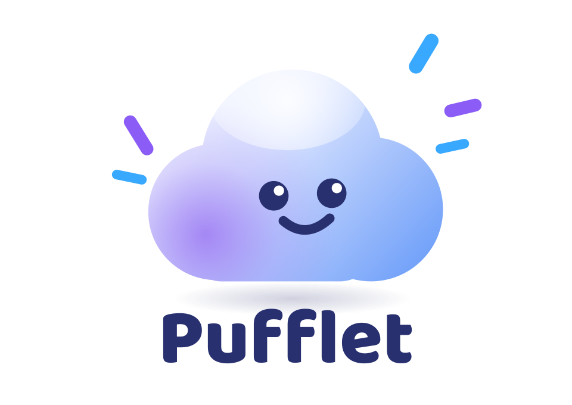

# Pufflet

**Personal cloud storage powered by Telegram.**

Pufflet is a self-hosted cloud storage web app with a familiar, Google Drive-style interface. It uses a private Telegram channel to store file data, while a database keeps track of filenames, folders, and other metadata. You can upload, organize, search, download, share, and restore files without opening Telegram.

Pufflet also provides a versioned REST API with scoped access tokens, so your scripts and applications can use the same storage.



## How It Works

```text
Browser --HTTPS--> Pufflet (Next.js) --Bot API--> Private Telegram Channel
                        |
                        v
                  Metadata Database
              (files, folders, users, API keys)
```

- **Telegram stores encrypted file data.** Before a file is uploaded, Pufflet wraps it in an AES-256-GCM vault container, adds random padding, and assigns it an opaque filename. Telegram receives the encrypted data rather than the original file contents.
- **The database manages your files.** It stores filenames, sizes, folder structures, checksums, and Telegram references, while the actual file data remains in your storage channel. When you download a file, Pufflet decrypts it and restores its original filename.
- **Your secrets stay on the server.** The Telegram bot token is never sent to the browser, and downloads pass through authenticated server routes instead of exposing direct Telegram URLs.

## Features

- **Simple setup:** Pufflet can create a default owner account on first launch, or you can disable automatic seeding and use the initial setup screen.
- **Account security:** Change your password from Settings, invalidate other sessions, and use database-backed sessions with HTTP-only cookies and login rate limiting.
- **File organization:** Create nested folders, rename and move files, use breadcrumbs, and prevent circular folder moves.
- **Streaming uploads:** Upload files with progress tracking, cancellation, retries, duplicate-name handling, and SHA-256 checksums.
- **Google Drive imports:** Import supported files directly from public Google Drive share links without downloading them to your device first.
- **External storage:** Connect supported rclone backends, including S3-compatible storage, Google Drive, SFTP, WebDAV, Dropbox, OneDrive, Azure Blob Storage, Backblaze B2, and local storage.
- **WebDAV support:** Connect external rclone installations and compatible WebDAV clients to your Pufflet instance.
- **Public sharing:** Generate share links with optional expiration, download counters, inline previews for supported formats, and link revocation.
- **Encrypted storage:** Protect new uploads with AES-256-GCM encryption, random padding, and opaque filenames.
- **File recovery:** Use starred files, recent files, trash, restore, permanent deletion, and empty-trash controls.
- **Search and navigation:** Search filenames, switch between list and grid views, and upload files through drag and drop.
- **REST API:** Use `/api/v1` with scoped API tokens for reading, writing, deleting, and administrative operations.
- **Audit and health monitoring:** Review audit records and structured logs, while `/api/health` provides a health endpoint.
- **Larger file support:** Run the official Local Bot API server to support files up to 2000 MB, subject to your server configuration and available resources.
- **State backups:** Keep a snapshot of the file index in a pinned Telegram document, allowing Pufflet to restore its database state when supported deployments restart.
- **Automated tests:** Run unit tests and end-to-end API tests without using real Telegram credentials.

## Telegram Bot API Limits

Pufflet supports both Telegram's hosted Bot API and the self-hosted Local Bot API server.

| Operation | Hosted Bot API | Local Bot API |
|---|---:|---:|
| Upload | 50 MB per file | Up to 2000 MB per file |
| Download | 20 MB per file | Up to 2000 MB per file |

These limits affect how Pufflet should be deployed. The hosted API is simpler to configure, while the Local Bot API server supports larger files when you have a suitable host.

On Vercel, uploads are additionally limited by the platform's request-body size restrictions, so configuring a Local Bot API server does not remove that separate limit.

Pufflet uses the documented Telegram API rather than relying on undocumented behavior. It also calculates SHA-256 checksums while streaming files, so file integrity does not depend on Telegram's file identifiers.

### Important Notes

- Telegram file identifiers are specific to the bot that created them. Switching bots can invalidate existing download references.
- Deleting a Telegram message permanently removes the associated stored file.
- Telegram storage is not a replacement for a complete backup strategy. Keep your metadata database and important configuration backed up.
- Database transactions cannot include Telegram API calls. Pufflet therefore orders upload and deletion operations to reduce inconsistent records and make failed operations easier to recover.

## Quick Start

### Requirements

- Node.js 20 or later, or Bun
- A Telegram bot token
- A private Telegram channel
- A database supported by your chosen configuration

### Installation

```bash
# 1. Install dependencies
bun install
# Or use: npm install

# 2. Create your environment file
cp .env.example .env

# 3. Configure your Telegram and database settings in .env

# 4. Create the database schema
bun run db:push

# 5. Start Pufflet
bun run dev
```

Open `http://localhost:3000` in your browser.

On a fresh installation, Pufflet may seed the following default owner account:

```text
Email:    pufflet@pufflet.com
Password: pufflet
```

**Change the default password immediately after your first login.** If you prefer to create your own account during setup, set `SEED_DEFAULT_USER="false"` in your environment file.

### Telegram Storage Setup

1. Open Telegram and message `@BotFather` to create a bot. Save the bot token as `TELEGRAM_BOT_TOKEN`.
2. Create a private Telegram channel and add your bot as an administrator.
3. Grant the bot permission to post, delete, and pin messages. Pinning is required for the state-backup feature.
4. Post a message in the channel, then retrieve your bot's updates through the Telegram Bot API to identify the channel's chat ID.
5. Set `TELEGRAM_CHAT_ID` in your environment file and restart Pufflet.
6. Open Settings and check that Telegram storage reports a successful connection.

Keep the channel private, and never publish your bot token or other secrets.

## Deployment

Pufflet can run locally, on a VPS, on a home server, or on a compatible Docker host. You can also separate the web application from the Local Bot API server, although that approach introduces additional configuration and platform-specific limits.

Choose a deployment that matches your budget and expected file sizes. Free hosting tiers may impose storage, bandwidth, runtime, and request-size limits, so check the provider's current terms before deploying.

### Option A: Vercel with an External Bot API Server

This setup runs the web application on Vercel and the Local Bot API server on a separate, always-on host.

It can be useful when you want managed web hosting, but the Vercel request-body limit still restricts uploads. Large-file uploads are better suited to a deployment where Pufflet can receive the request body directly.

#### Overview

1. Deploy the official Local Bot API server on a compatible host.
2. Create a PostgreSQL database and configure its connection string.
3. Import the Pufflet repository into Vercel.
4. Set the required environment variables.
5. Deploy the application and verify the Telegram connection.

Typical environment variables include:

| Variable | Purpose |
|---|---|
| `DATABASE_URL` | PostgreSQL connection string |
| `TELEGRAM_BOT_TOKEN` | Telegram bot token |
| `TELEGRAM_CHAT_ID` | Private storage channel ID |
| `TELEGRAM_API_BASE` | URL of your Local Bot API server |
| `MAX_UPLOAD_MB` | Application upload limit, subject to Vercel's lower platform limit |
| `MAX_DOWNLOAD_MB` | Application download limit |
| `STATE_BACKUP` | Enable or disable Telegram-based state snapshots |
| `SEED_DEFAULT_USER` | Control default account creation |

Set each value according to your deployment, and store secrets only in the provider's environment settings.

**Vercel has platform-specific request and execution limits.** Check its current documentation before relying on this setup for large uploads or downloads.

### Option B: Render

Render can run Pufflet's Docker image directly, including the application and, when configured, the embedded Local Bot API server.

1. Create a new Web Service and connect your Pufflet repository.
2. Select Docker as the runtime if it is not detected automatically.
3. Configure `TELEGRAM_BOT_TOKEN` and `TELEGRAM_CHAT_ID`.
4. If you want to use the embedded Local Bot API server, configure `TELEGRAM_API_ID` and `TELEGRAM_API_HASH`.
5. Configure a persistent database or external PostgreSQL database if your plan supports it.
6. Deploy the application and change the default account password immediately after logging in.

The embedded Local Bot API server requires the Telegram API ID and hash obtained from [my.telegram.org](https://my.telegram.org). These credentials are different from your bot token.

If the bot has previously used Telegram's hosted Bot API, a one-time logout may be required before switching it to a Local Bot API server. Follow the migration instructions below before making that change.

#### Hosting Considerations

Free instances may sleep or use ephemeral storage. If your database is stored on an ephemeral disk, its contents may disappear after a restart or deployment, and a Telegram state snapshot can restore only the data included in that snapshot.

When using the embedded Local Bot API server, cached file data may also be lost if the host's disk is reset. Telegram may retain the original messages, but the local server's cached download state may need to be rebuilt.

For reliable long-term storage, use persistent storage where available and maintain independent backups.

### Option C: Docker or a VPS

For more control, run Pufflet on a VPS, home server, or another Docker-compatible host.

#### Docker Compose

```bash
cp .env.example .env
# Configure your Telegram credentials and other settings.

npm run tg:logout
docker compose up -d
```

The logout command is needed only when migrating a bot from Telegram's hosted Bot API to a Local Bot API server. Review the migration notes before running it.

#### All-in-One Docker Image

```bash
docker build -t pufflet .
docker run -p 3000:7860 --env-file .env pufflet
```

The all-in-one image can run the application with an embedded Local Bot API server when the required configuration is provided.

For production use, configure persistent storage, set `NODE_ENV=production`, use HTTPS through a reverse proxy, and protect the server's environment variables.

### Switching to the Local Bot API

Telegram requires the bot to log out from the hosted Bot API before it can connect to a Local Bot API server.

Run the migration command from your local project environment:

```bash
npm run tg:logout
```

This operation has consequences. File identifiers issued by the hosted API may stop working after the switch, so files uploaded before migration may need to be uploaded again to refresh their references.

Do not run this command unless you intend to migrate the bot.

## State Backup

Pufflet stores file contents in Telegram, but its database contains the information needed to organize and locate those files. To help recover from database loss on supported deployments, Pufflet can save a snapshot of its state as a pinned document in the storage channel.

The backup system works as follows:

- After relevant changes, Pufflet refreshes the state snapshot.
- When the application starts with an empty database, it can restore the snapshot if one is available.
- The snapshot includes information needed to rebuild the file index and may contain account, API-key, and encryption settings.
- Temporary sessions and other transient records are not included.

You can check the backup status and trigger a manual backup from **Settings → Data safety**.

The storage channel must remain private. A leaked backup may expose sensitive metadata, so restrict channel access and protect the bot token and hosting environment.

Set `STATE_BACKUP="false"` to disable this feature when appropriate, such as when relying on a persistent external database.

## Vault Encryption

Pufflet can encrypt uploaded files before sending them to Telegram. Each encrypted file is wrapped in a `PUFFENC1` container that uses AES-256-GCM, a unique nonce, and an authentication tag to protect confidentiality and detect tampering.

Pufflet also obscures stored file information:

- **Opaque filenames:** Files are stored with generated names such as `pf-<random>.bin`.
- **Generic content type:** Files are sent as `application/octet-stream`.
- **Random padding:** Additional encrypted padding introduces some variation in stored file sizes.

When a file is downloaded, Pufflet detects the encrypted container and decrypts it before returning the original contents. Files uploaded before vault encryption was introduced remain supported.

### Encryption Key Options

| Mode | Configuration | Behavior |
|---|---|---|
| Passphrase | Set `PUFFLET_ENCRYPTION_KEY` | Pufflet derives the encryption key from the configured passphrase using scrypt. The derived key is not stored as the automatic vault key in the database. |
| Automatic | Leave `PUFFLET_ENCRYPTION_KEY` unset | Pufflet generates a random 256-bit key and stores it in the database settings, allowing the state backup to preserve it for recovery. |

**Passphrase mode is recommended when you want the encryption key kept separate from the Telegram backup.** Keep the passphrase secure and store a recovery copy somewhere outside Telegram, because losing it can make encrypted files unrecoverable.

Pufflet uses server-side at-rest encryption, not end-to-end encryption. The server needs access to the encryption key to decrypt files for downloads, so someone who compromises the server may also be able to access the files.

For stronger protection against a compromised hosting provider or leaked storage channel, encrypt sensitive files on your own device before uploading them.

Changing `PUFFLET_ENCRYPTION_KEY` without following the project's migration procedure can make existing encrypted files unreadable. Back up your key and review the migration instructions before changing the configuration.

To disable encryption for new uploads, set `PUFFLET_ENCRYPTION="false"`. Existing vault containers can still be decrypted while the appropriate key remains available.

## Share Links

Pufflet lets you create public download links for individual files without requiring recipients to sign in.

- Each link uses a random token that is difficult to guess.
- Recipients can download the file through a dedicated page.
- Supported images, videos, and PDFs may be previewed in the browser.
- Links can be revoked and may support an optional expiration date.
- Download counts and rate limiting help manage public access.

Anyone with a valid share link can access the file associated with that link, so avoid sharing sensitive files publicly. Share links are included in supported state snapshots so they can be restored with the rest of the index.

See [docs/API.md](docs/API.md) for the share-link API endpoints.

## Import from Google Drive

Use **Upload → From Google Drive** to import a supported file from a share link.

The server retrieves the file from Google Drive and streams it through Pufflet's upload pipeline, which means your device does not need to download the file first.

The file must be accessible through a regular Google Drive share link, typically with access set to **Anyone with the link**. Private files, folders, Google Docs, Sheets, and Slides links are not supported by this import flow.

The normal Pufflet upload limit applies. The available file size depends on the Telegram API configuration and the hosting platform's own limits.

## Folder Uploads

Pufflet supports uploading complete folders through the folder picker or drag and drop. It preserves the directory structure by creating corresponding folders and uploading the files into them.

Existing folders with matching names can be reused instead of duplicated. Empty folders may be created through drag and drop, although some browser folder pickers do not expose empty directories.

The normal file-size and folder-depth limits still apply.

## rclone Storage

Pufflet can connect to external storage backends through rclone. Configure supported remotes in **Settings → rclone Storage**, then browse, import, export, or synchronize files.

Supported backends include:

- S3-compatible storage
- Google Drive
- SFTP
- WebDAV
- Dropbox
- OneDrive
- Azure Blob Storage
- Backblaze B2
- Local server storage

Credentials are encrypted on the server and masked in API responses. Depending on the provider, you may need to generate authorization credentials with rclone on your own device.

Folder sync jobs can push Pufflet folders to a remote or import remote folders into Pufflet. Review the sync direction and behavior before running a job, especially when working with important files.

The `local` backend can expose the server's filesystem, so enable it only when you trust the users who can access that instance.

The rclone binary must be installed on the server. The Docker image includes it, and other deployments can specify its location with `PUFFLET_RCLONE_PATH`.

Set `PUFFLET_RCLONE="false"` to disable the feature.

## Pufflet as a WebDAV Remote

Pufflet can expose its own storage through WebDAV at `/api/dav`, allowing compatible clients and external rclone installations to connect to it.

Example rclone configuration:

```bash
rclone config create pufflet webdav \
  url https://<your-pufflet>/api/dav \
  vendor other \
  user pufflet \
  pass "$(rclone obscure <API-KEY>)"
```

Use a scoped API key as the WebDAV password. Grant only the permissions needed by the client, because write and delete permissions allow it to modify or remove files.

Pufflet supports common WebDAV operations, although it does not provide every WebDAV feature. See the API documentation for details.

## Configuration and Security

Pufflet includes several protections, but secure deployment still depends on how you configure and maintain the server.

- Server routes require an authenticated session or a properly scoped API token.
- Passwords are hashed using scrypt with per-user salts.
- API tokens are generated using cryptographically secure randomness and stored as hashes.
- API token scopes, expiration, and revocation are enforced by the server.
- Filenames are sanitized, and download headers are constructed to reduce injection risks.
- Login and API authentication have rate limits.
- Logs redact sensitive information where supported.
- Vault encryption uses AES-256-GCM, authenticated headers, and random padding.

For a safer deployment:

1. Change the default password immediately.
2. Keep the Telegram channel private and restrict its members.
3. Never commit `.env` or publish bot tokens, database credentials, API keys, or encryption passphrases.
4. Use HTTPS in production.
5. Keep the database and important configuration backed up.
6. Use `PUFFLET_ENCRYPTION_KEY` if you want the vault key kept separate from the automatic database backup.
7. Encrypt especially sensitive files on your own device before uploading them.

Encryption is only one part of security. Protect the hosting account, database, and Telegram bot as carefully as the storage channel.

## Testing

Run the unit tests and lint checks with:

```bash
bun test
bun run lint
```

The end-to-end API suite uses a local mock Telegram Bot API, so you can test core operations without real Telegram credentials.

```bash
cd mini-services/telegram-mock
bun run index.ts
```

In another terminal, start the Pufflet development server and run:

```bash
bun run test:e2e
```

The tests cover authentication, uploads, downloads, retries, duplicate handling, trash and restore operations, folder validation, API token scopes, and other core behavior.

## Repository Layout

```text
src/app/                    Next.js application and API routes
src/app/api/v1/             Versioned REST API
src/app/api/backup/         State snapshot endpoints
src/components/pufflet/     User interface components
src/lib/                    Core services and utilities
src/lib/state-backup.ts     State snapshot and restore logic
src/instrumentation.ts      Startup and background initialization
prisma/schema.prisma        Default database schema
Dockerfile                  All-in-one Docker image
docker-compose.yml          Application and Local Bot API services
scripts/tg-logout.mjs       Hosted-to-local Bot API migration
scripts/e2e_api_test.sh     End-to-end API test suite
mini-services/telegram-mock Mock Telegram Bot API for testing
tests/unit/                 Unit tests
docs/API.md                 REST API documentation
vercel.json                 Vercel build configuration
```

## Known Limitations

- Pufflet is designed primarily for personal use and does not include a distributed rate limiter by default.
- Search covers filenames and metadata rather than the contents of files.
- The hosted Telegram Bot API has a 20 MB download limit, while the Local Bot API server supports larger files when properly configured.
- Hosting providers may impose their own upload, download, execution-time, storage, and bandwidth limits.
- Ephemeral hosting can lose local database data and local Bot API cache data after restarts.
- Restoring a state snapshot restores only the information it contains; it cannot recover a Telegram file message that has been permanently deleted.
- State backup requires the bot to have permission to pin messages in the storage channel.
- Vault encryption is server-side at-rest encryption, not end-to-end encryption.

## License

See the repository's license file for the applicable license terms.
